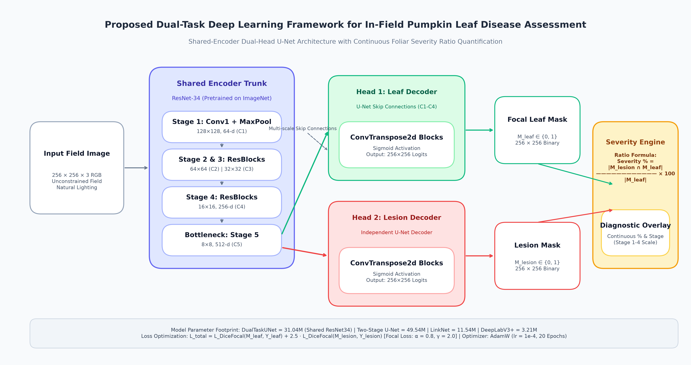

# Pumpkin Leaf Disease Localization, Segmentation, and Severity Estimation

[](https://www.python.org/downloads/)
[](https://pytorch.org/)
[](https://opensource.org/licenses/MIT)

A multi-task and cascaded deep learning framework for focal leaf isolation, pathological lesion segmentation, and continuous foliar disease severity estimation in open pumpkin fields.

---

## Table of Contents
* [Overview](#overview)
* [System Architecture](#system-architecture)
* [Key Empirical Findings](#key-empirical-findings)
  * [1. Published Classification Re-implementation](#1-published-classification-re-implementation)
  * [2. 5-Fold Cross-Validation Segmentation Benchmark](#2-5-fold-cross-validation-segmentation-benchmark)
* [Repository Structure](#repository-structure)
* [Getting Started](#getting-started)
* [Citation](#citation)

---

## Overview

Existing literature on pumpkin foliar disease is dominated by image-level classification (86%–96% accuracy). However, under uncontrolled field conditions:
1. **Semantic Granularity Gap:** A single categorical label cannot distinguish a 2% trace infection from a 60% destructive epidemic.
2. **Canopy Clutter:** In multi-leaf vine canopies, whole-image models cannot indicate which leaf is diseased.
3. **Absence of Quantitative Masks:** Pixel-level leaf and lesion annotations have been absent from the reviewed pumpkin literature.

This repository provides the complete experimental suite, re-implementations, segmentation benchmark, and continuous severity estimation pipeline.

---

## System Architecture



Our primary architecture, **DualTaskUNet**, utilizes a shared ResNet-34 encoder with dual decoders predicting focal leaf boundaries ($M_{\text{leaf}}$) and pathological lesions ($M_{\text{lesion}}$) at $256 \times 256$ resolution. 

$$\text{Severity \%} = \frac{|M_{\text{lesion}} \cap M_{\text{leaf}}|}{|M_{\text{leaf}}|} \times 100\%$$

Loss formulation incorporates composite DiceFocal loss with class balancing:
$$\mathcal{L}_{\text{total}} = 1.0 \cdot \mathcal{L}_{\text{DiceFocal}}(M_{\text{leaf}}) + 2.5 \cdot \mathcal{L}_{\text{DiceFocal}}(M_{\text{lesion}}) \quad [\alpha = 0.8, \, \gamma = 2.0]$$

---

## Key Empirical Findings

### 1. Published Classification Re-implementation
Re-implemented under a common standardized protocol on Tesla T4 GPUs:

| Model Architecture | Source Study | Reported Acc (%) | Replicated Acc (%) | Split Protocol | Discrepancy (pp) |
| :--- | :--- | :---: | :---: | :---: | :---: |
| **ResNet-50** | Khandaker et al. (2024) [5] | 90.50% | **88.00%** | 80/10/10 | -2.50 |
| **DenseNet-121** | Khaldi & Kalmoun (2024) [7] | 86.00% | **83.50%** | 80/10/10 | -2.50 |
| **DenseNet-121** | Gakhar et al. (2025) [8] | 94.00% | **80.50%** | 70/20/10 | -13.50 |
| **DualFusion-CBAM** | Bhuria et al. (2026) [9] | 96.00% | **85.00%** | 80/10/10 | -11.00 |
| **MobileNetV3-Large** | Brar et al. (2025) [10] | 88.00% | **84.50%** | 80/10/10 | -3.50 |
| **ResNet-50** | Kumar et al. (2026) [11] | 91.00% | **85.50%** | 80/10/10 | -5.50 |

*Discrepancy Analysis:* Binomial sampling error on 200 test images ($SE_{\text{diff}} \approx \pm 3.5$ pp) accounts for smaller margins. Large drops in Gakhar and DualFusion remain unexplained by variance alone, likely reflecting undocumented training hyperparameters or potential data leakage across random splits in original publications.

---

### 2. 5-Fold Cross-Validation Segmentation Benchmark
Evaluated across 80 pilot field images (20 DM, 20 HL, 20 MD, 20 PM; 16 test images per fold):

| Model Architecture | Params (M) | Leaf Dice (Lamina) | Lesion Dice (Diseased) | Severity MAE (Diseased) | Severity MAE (Overall) |
| :--- | :---: | :---: | :---: | :---: | :---: |
| **DualTaskUNet (Ours)** | 31.04M | **0.9584 ± 0.0100** | **0.8456 ± 0.0153** | 4.06% ± 2.64% | 7.19% ± 3.00% |
| **Two-Stage Separate U-Net** | 49.54M | 0.9540 ± 0.0028 | 0.8019 ± 0.0079 | **3.21% ± 0.91%** | **3.72% ± 1.77%** |
| **LinkNet-ResNet18** | 11.54M | 0.9434 ± 0.0121 | 0.7621 ± 0.0216 | 4.17% ± 0.79% | 4.71% ± 1.24% |
| **DeepLabV3+ (MobileNetV2)**| 3.21M | 0.9342 ± 0.0103 | 0.7246 ± 0.0353 | 4.15% ± 1.70% | 4.25% ± 0.86% |
| **Classical Baseline (HSV+Otsu)**| 0.00M | 0.9376 ± 0.0339 | 0.0696 ± 0.0566 | 18.99% ± 14.65% | 22.67% ± 14.60% |

#### Key Architectural Trade-Off
* **Multi-Task Feature Sharing:** DualTaskUNet achieved higher lesion Dice across all 5 folds (+4.37 pp over Two-Stage; +8.35 pp over LinkNet), supporting the hypothesis that shared encoder features sharpen lesion boundary delineation.
* **Healthy False Alarms:** Unconstrained decoders incur false-alarm errors on healthy leaves (mean 16.59% MAE), raising DualTaskUNet overall MAE to 7.19%. Two-Stage U-Net limits healthy error to 5.25% by cropping the leaf first.
* **Mitigation:** We propose Upstream Classification Confidence Gating (using the ResNet-50 backbone classifier, $\tau=0.85$ calibrated on validation folds) to zero out false positive lesion masks on healthy foliage.

---

## Repository Structure

```
├── README.md                               <- Master project overview & empirical benchmark
├── requirements.txt                        <- Python environment dependencies
├── data/
│   ├── README.md                           <- Dataset download and annotation guidelines
│   ├── dataset_audit_sheet_200.xlsx        <- 200-image clutter audit protocol & rubric
│   └── splits/
│       ├── cv5_segmentation_splits.json    <- Stratified 5-fold CV splits (80 pilot images)
│       ├── pilot_100_manifest.csv          <- Pilot cohort image metadata
│       └── pilot_100_severity_annotations.csv <- Verified pilot continuous severities
├── notebooks/
│   ├── 01_classification_resnet50.ipynb
│   ├── 02_classification_densenet121.ipynb
│   ├── 03_classification_densenet121_gakhar.ipynb
│   ├── 04_classification_dualfusion_cbam.ipynb
│   ├── 05_classification_mobilenetv3_large.ipynb
│   ├── 06_classification_resnet50_kumar.ipynb
│   ├── 07_segmentation_dualtask_unet_train.ipynb
│   ├── 08_segmentation_dualtask_unet_cv5.ipynb
│   ├── 09_segmentation_twostage_unet_cv5.ipynb
│   ├── 10_segmentation_5fold_benchmark.ipynb
│   ├── 11_segmentation_linknet_resnet18_cv5.ipynb
│   ├── 12_segmentation_deeplabv3plus_cv5.ipynb
│   └── 13_severity_estimation_pipeline.ipynb
└── results/
    ├── run_log.csv                         <- Full training run records
    ├── segmentation_cv5_benchmark.csv      <- Per-fold segmentation evaluation metrics
    ├── classification_comparison.csv       <- Replication comparison table
    └── figures/
        ├── framework_diagram.png
        ├── dataset_samples_grid.png
        └── figure1_field_powdery_mildew.png
```

---

## Getting Started

### Installation
```bash
git clone https://github.com/mhjayeed715/pumpkin-leaf-disease-localization-severity.git
cd pumpkin-leaf-disease-localization-severity
pip install -r requirements.txt
```

### Running the Segmentation Benchmark
To reproduce the 5-fold cross-validation segmentation benchmark:
```bash
jupyter notebook notebooks/10_segmentation_5fold_benchmark.ipynb
```

---

## Citation & References
1. Tahmid Mir. *Pumpkin Leaf Diseases Dataset (from Bangladesh)*. Kaggle, 2023.
2. M. A. A. Khandaker et al. *Explainable AI-enhanced deep learning for pumpkin leaf disease detection*. In Proc. 27th ICCIT, 2024.
3. A. Khaldi and E. M. Kalmoun. *Automated disease diagnosis in pumpkin plants using advanced CNN models*. arXiv:2410.00062, 2024.
4. D. Gakhar et al. *Pumpkin leaf disease detection using DenseNet-121*. In Proc. DASA, 2025.
5. R. Bhuria et al. *AI-powered detection of pumpkin leaf diseases using DualFusion-CBAM-stochastic*. Front. Plant Sci., vol. 16, 2026.
6. R. Brar et al. *Smart detection of pumpkin leaf diseases using MobileNetV3*. In Proc. ICICIS, 2025.
7. D. L. Kumar et al. *ResNet50 pipeline for multi-class pumpkin leaf disease diagnosis in field conditions*. In Proc. MPCON, 2026.
